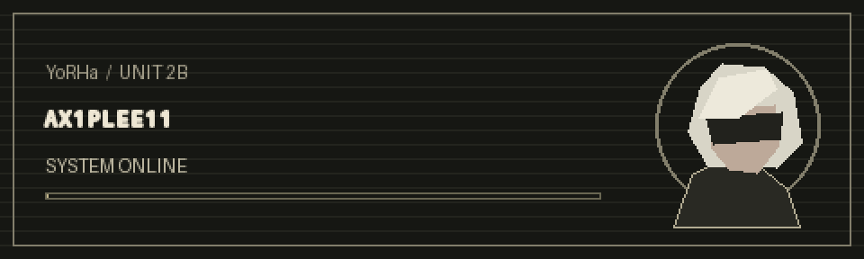

# ax1plee11

Разрабатываю Zenthril и ZenthrilDB.

| Проект | Описание |
| --- | --- |
| [Zenthril](https://github.com/ax1plee11/Zenthril) | Самостоятельно размещаемый мессенджер на Go, React и Tauri. Альфа с экспериментальной E2EE. |
| [ZenthrilDB](https://github.com/ax1plee11/ZenthrilDB) | Движок хранения на C++23 с KV CLI, WAL, восстановлением и проверяемыми снимками. |

[Веб-клиент Zenthril](https://ax1plee11.github.io/Zenthril/)
