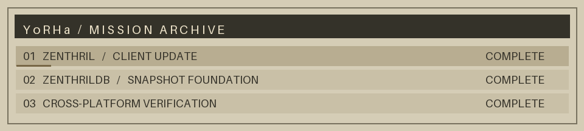

# YoRHa · досье ax1plee11

Разрабатываю мессенджер Zenthril и движок хранения ZenthrilDB.

| Терминал | Проект |
| --- | --- |
| **01 · Связь** | [Zenthril](https://github.com/ax1plee11/Zenthril) — self-hosted мессенджер на Go, React и Tauri. Альфа с экспериментальной E2EE. [Веб-клиент](https://ax1plee11.github.io/Zenthril/) |
| **02 · Хранилище** | [ZenthrilDB](https://github.com/ax1plee11/ZenthrilDB) — движок на C++23 с KV CLI, WAL, восстановлением и проверяемыми снимками. |

## Архив выполненных задач

| Задача | Выполнено | Запись |
| --- | --- | --- |
| **01 · Обновление клиента** | Обновлён интерфейс Zenthril, веб-клиент опубликован на GitHub Pages. | [Коммит](https://github.com/ax1plee11/Zenthril/commit/ce95b2c) |
| **02 · Базовый снимок** | ZenthrilDB получила манифест, проверку и публикацию снимков, восстановление страниц. | [Коммит](https://github.com/ax1plee11/ZenthrilDB/commit/045fa27) |
| **03 · Проверка сборок** | Debug и Release прошли CTest и проверку CLI на Windows и Ubuntu 24.04. | [GitHub Actions](https://github.com/ax1plee11/ZenthrilDB/actions/runs/43954679734) |
